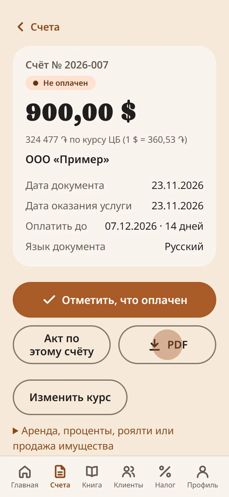

# Kvartik

<a href="https://kvartik.com/ru/"></a>

Сайт — <https://kvartik.com>, программа — <https://kvartik.com/app/>.

**Kvartik** — программа для индивидуальных предпринимателей Армении
(ԱՁ, ИП) на налоге с оборота и микропредпринимательстве. В ней выписывают
счёт и акт сдачи-приёмки на армянском, русском или английском и получают
PDF, ведут книгу доходов и расходов
в драмах, долларах и евро, видят налог квартал за кварталом, сроки отчёта
и оплаты и готовые числа для отчёта — чтобы подать его самому или отдать
бухгалтеру. Она для IT-фрилансеров с иностранными клиентами, ИП-релокантов
и тех, кто оказывает услуги на месте; позже — и для бухгалтеров, которые
ведут много ИП сразу. ООО, плательщиков НДС, зарплаты и обмена с госсистемами
в первой версии нет.

Kvartik открывается в браузере, на компьютере и на телефоне, и ставить
ничего не нужно. Данные живут на устройстве пользователя: базы с ними
у программы нет, и с устройства они не уходят — кроме вопросов
ИИ-помощнику, которые уходят прямо выбранному вами поставщику ИИ. Поэтому резервная копия —
файл со всеми данными, зашифрованный вашим паролем, — делается в любой
момент, а через неделю без неё программа напоминает о копии: браузер может
стереть данные сам, и файл копии — единственная страховка. После первой
копии с паролем следующие делаются одним нажатием: пароль копий программа
спросит раз в 30 дней, чтобы он не забылся. Копия больше
128 МБ — например, с фото чеков за год — делится на несколько файлов, и каждый
из них восстанавливается сам, в любом порядке. В Chrome и Edge
на компьютере копию можно поручить программе: после изменений она сама
ложится в папку «Kvartik» внутри выбранной папки OneDrive, Google Drive или
Dropbox. Без сети
работает всё, кроме загрузки новой версии. Программу можно установить как
приложение — со своим значком и в своём окне. Новая версия ставится сама,
а пока открыта форма или начат ввод, ждёт, чтобы начатое не пропало; что
в ней нового, программа показывает окном «Что нового» после обновления.
Налог программа
считает по открытому закону и показывает правило, по которому посчитала; сверить
расчёт она советует с бухгалтером.

## Статус

Ранняя разработка: выпусков ещё нет, налоговые правила ещё не сверены с бухгалтером.
Что нового в каждой сборке — в [CHANGELOG.md](CHANGELOG.md), задачи — в
[FEATURE_TASKS.md](FEATURE_TASKS.md).

**Готово**

- Счета и акты на трёх языках, PDF и «Отправить PDF»; отметка и файл XML расчётного документа ՊԵԿ.
- Клиенты, профиль ИП, книга доходов и расходов в AMD, USD и EUR с курсом ЦБ, выгрузка XLSX и CSV.
- Налог с оборота за квартал, микропредпринимательство, годовые платежи, сроки и календарь сроков,
  числа для расчёта ՊԵԿ.
- Данные на устройстве, работа без сети, копия под паролем и автокопия в папку, несколько ИП.
- Обмен с другим устройством без сервера — QR-кодами или текстом, в обе стороны за один сеанс:
  принявшее показывает квитанцию и тем же ключом, без второго пароля, — код со своими изменениями.
- Пробный ключ, ключи «Стандарт» и «Pro», страница «Купить»; ИИ-помощник с ключом своего ИИ.
- Сайт на трёх языках: калькулятор, ролик и снимки, условия, политика, отзывы и предложения.

**В работе**

- Сверка расчёта с бухгалтерами на настоящих ИП и ответы ՊԵԿ на вопросы (строка 0.2 «Плана»).
- Бета: 20 пользователей, 10 из них закрывают квартал в программе (0.3).
- Запуск: оплата и каналы продаж (1.0).

**Чего нет в первой версии**

- ООО, плательщиков НДС, зарплаты и работников.
- Обмена с системами ՊԵԿ: расчёт подаёт человек сам — программа даёт числа и файл.
- Сервера и синхронизации: данные — только на устройстве и в файле копии.
- Грузии и других стран (1.2).

## План

Номер версии означает, что всё из её строки уже работает. Пока строка
в работе, сборки носят промежуточные номера: на пути к 0.1 это 0.0.1, 0.0.2
и так далее. Строки и признаки готовности взяты из 90-дневного плана
в описании проекта. Конкретные задачи и найденные дефекты лежат
в [FEATURE_TASKS.md](FEATURE_TASKS.md).

| Версия | Что появится | Признак готовности | Состояние |
|---|---|---|---|
| 0.1 Ядро | профиль, клиенты, счёт и акт в PDF, книга доходов и расходов; хранение на устройстве, резервная копия, работа без сети | человек сам отправил свой счёт из приложения | в работе: каркас, хранилище, резервная копия, работа без сети, профиль ИП, клиенты, счета и акты, PDF и его отправка, книга доходов и расходов готовы |
| 0.2 Налоги | налоговые правила, налог квартала, годовые платежи, сроки, отчёт, лицензия | два бухгалтера сверили расчёт на пяти настоящих ИП | в работе: файл налоговых правил, налог квартала с порогом, годовые платежи, сроки и календарь сроков, отметка о расчётных документах ՊԵԿ, числа для расчёта ՊԵԿ, лицензия и пробный ключ готовы |
| 0.3 Бета | первый запуск, автокопия, экспорт, юридические тексты, 20 пользователей | 10 пользователей закрыли квартал в приложении | в работе: первый запуск и первые шаги, автокопия, экспорт, юридические тексты и страница отзывов и предложений готовы |
| 1.0 Запуск | лендинг и бесплатный калькулятор, оплата, каналы продаж | 100 платящих или 2,4 млн ֏ годового дохода по договорам | в работе: лендинг на трёх языках со снимками и роликом программы, калькулятор с переносом введённого в программу и страница «Купить» с оплатой переводом и ключом вручную готовы |
| 1.1 Pro | несколько ИП в одной программе, сводная таблица | — | готово (закрыта 2026-11-17, решение человека): несколько ИП в одной программе, копия всех ИП и копия только одного ИП, ключ «Pro» с числом мест и сводная таблица; «Pro» продаётся с 0.0.144 — 10 ИП на год за 120 000 ֏ |
| 1.2 Грузия | правила Грузии, грузинский язык | — | впереди |

## Сборка из исходников

Нужен [Rust](https://rustup.rs) **1.100 или новее** (stable, edition 2024).
Это тот Rust, на котором Kvartik собирается и проверяется, и с его
обновлениями число растёт. Уже стоящий Rust обновляется командой
`rustup update`.

Окно собирается в WebAssembly, поэтому один раз нужны цель wasm32 и сборщик
[Trunk](https://github.com/trunk-rs/trunk):

```
rustup target add wasm32-unknown-unknown
cargo install trunk --locked --version 0.22.1
```

Trunk нужен 0.22.1 или новее из 0.22: со старым сборка откажется работать.

Ещё нужны две программы в PATH: `wasm-bindgen` **0.2.130** (та же версия,
что крейт `wasm-bindgen` в `Cargo.lock`) и `wasm-opt` из binaryen
**version_133**. Их берут готовыми из выпусков на GitHub —
`wasm-bindgen-0.2.130-<система>.tar.gz` в
[wasm-bindgen](https://github.com/wasm-bindgen/wasm-bindgen/releases/tag/0.2.130)
и `binaryen-version_133-<система>.tar.gz` в
[binaryen](https://github.com/WebAssembly/binaryen/releases/tag/version_133),
сверив сумму sha256 с файлом суммы рядом с архивом, — и кладут, например,
в `~/.cargo/bin`. Окно режется на части, которые грузятся по нажатию, и эти
программы зовёт сборка сама; не той версии — она остановится и скажет об
этом.

Посмотреть программу в браузере — `trunk serve` из `crates/app`, потом
открыть <http://127.0.0.1:8080/app/>:

```
git clone https://github.com/cholakhyanerik/kvartik
cd kvartik/crates/app
trunk serve
```

Сайт для выкладки собирает `trunk build --release` (тоже из `crates/app`)
в папку `crates/app/dist/` — это обычные статические файлы: программа —
в `app/`, а в корне — страницы лендинга на трёх языках, карта сайта для
поисковиков, настройки хостинга и страница для неизвестного адреса.
Выкладывает их на Cloudflare Pages
только CI, после зелёных проверок: push в `main` — на
<https://kvartik.com/app/> (прежний адрес kvartik.pages.dev переадресует
на kvartik.com), pull request — предпросмотр на своём адресе. Работу без
сети, установку и новую версию видно только в выпускной сборке: service
worker в отладке не включается. Смотреть её лучше на другом порту, не
8080, — например, `trunk serve --release --port 8081` и
<http://127.0.0.1:8081/app/>.

## Как устроен код

Rust 2024, шесть крейтов: `kvartik-core` (`crates/core/`) — всё, что
проверяется без браузера: налог, сроки, деньги, документы, формат данных;
`kvartik-app` (`crates/app/`) — окно на Leptos (CSR) в WebAssembly;
`kvartik-ai` (`crates/ai/`) — ИИ-помощник своим wasm на своём адресе
`ai.kvartik.com`, рамкой в окне;
`kvartik-keygen` (`crates/keygen/`) — выпуск ключей лицензии на машине
автора, в сайт не попадает; `kvartik-calc` (`crates/calc/`) — калькулятор
лендинга, свой маленький wasm на расчёте ядра; `kvartik-sw` (`crates/sw/`) — шаг сборки,
который раскладывает сайт (программа — в `/app/`, в корне — лендинг,
написанный из той же таблицы строк, что окно), режет wasm окна на части
и пишет `sw.js` для работы без сети. Слои,
их границы и правила работы над кодом
описаны в [CLAUDE.md](CLAUDE.md), а подробности по областям — в
[.claude/rules/](.claude/rules/); проверки оттуда же CI гоняет на каждый
push. Дизайн окна — «Kvartik Design»,
[docs/design/kvartik-design.html](docs/design/kvartik-design.html):
страница открывается в браузере.

## Что изменилось

Что нового в каждой версии, лежит в [CHANGELOG.md](CHANGELOG.md), свежие
версии сверху.

## Что дальше

Рабочий список задач и найденных дефектов — в
[FEATURE_TASKS.md](FEATURE_TASKS.md), самое важное сверху.
